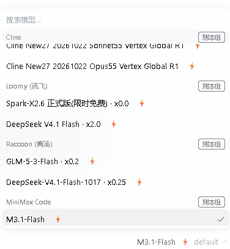
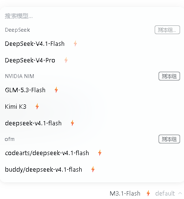

# 更好的用户体验（local-model-speedtest）

给 DSH 加两个小功能：

1. **模型测速**：点一下就知道某个模型的首字延迟和生成速度，支持按渠道一次测全组。
2. **报错大白话解释**（仅 DSH 桌面端）：对话某一轮失败时，报错旁边多一个「大白话解释」按钮，让模型把原始报错翻译成「原因 + 你可以怎么做」。

仓库：<https://github.com/atattier/local-model-speedtest>



## 功能一：模型测速

**桌面版 / 网页版**

输入框上方模型选择器里，每个模型名旁边多一个 **⚡**；每个渠道的分组标题右侧有 **测本组** 按钮。

- 点 ⚡ → 真实测一次，名字后显示 `1.43s · 66.5 tok/s`；等待时旁边会实时走秒
- 结果用小药丸显示：测过 = 绿色结果，没测过 = 灰色「未测」，失败 = 红色「✗ 超时/失败」（悬停看完整原因）
- ⚡ 是琥珀色小圆钮：测完弹一下，失败抖一下，测试中会轻轻跳动；组名旁的「测本组」也是圆药丸
- 测速只取样：拿到几十个 token 就收尾，不再等整段输出；卡住的渠道最多等 15–22 秒
- ⚡ 右边还会标出模型能力：**视觉 / 文本** 和上下文长度，例如 `视觉 · 1M`（鼠标悬停看完整说明）
- 点分组标题上的「测本组」→ 一次测完同渠道全部模型（并发 3）
- 结果缓存，刷新后还在；1 小时后自动标记为「旧」



**手机（dsh-go）**

「全部功能」或对话详情页「插件」页签里的 **模型测速** 面板。

- 按 provider 分组：`▸ 渠道名  16 个模型 · 已测 3  ⚡ 测全部`
- 点组名 → 后台一次测完该组全部模型（并发 3），结果实时刷新，有「停止测速」
- 点单个模型行 → 只测它自己
- 输入框上方状态条显示最近一次结果，点一下打开面板

### 怎么测的

- 发一句固定短句，要求模型原样复述；普通模型 `maxTokens=160`，思考模型自动放宽到 `384`（否则 160 个 token 全被“想”掉，正文根本出不来）
- 采样式收尾：普通模型拿到 32 个正文 token、思考模型拿到 24 个就停止；首个正文 token 后最多再采 3 秒，避免慢模型拖住界面
- 首字延迟 = 第一个 token 到达时间 − 请求发出时间
- **正文首字**：思考模型会先输出一段 reasoning，界面优先展示“第一个正文 token”的时间，并在提示里单列「思考 Xs」
- tok/s = 输出 token 数 ÷（最后一个 token 时间 − 第一个 token 时间）
- 输出 token 数优先用渠道返回的 usage.outputTokens，没有就用收到的增量条数
- 思考模型的识别：优先看模型元数据（`reasoning` / `capabilities.reasoning`），否则按 id 里的 `r1`、`o1/o3`、`qwq`、`reasoner`、`thinking` 等片段判断；超时也相应放宽（普通 22s / 思考 26s），免得卡死的渠道把人晾着

## 功能二：报错大白话解释（仅桌面端）

对话里出现「本轮运行失败」时，错误标题旁边会多一个 **大白话解释** 小按钮。


- 点一下，让一个模型把原始报错翻译成两行：`原因：……` / `你可以：……`
- **解释用哪个模型由你选**：面板里按渠道分组列出全部模型；默认自动挑一个免费模型（优先明确标注「限时免费」的，其次免费渠道里的模型），选择会记住
- 默认模型如果提示「需要 Bun」，说明那个免费车道依赖 Bun：换一个模型，或安装 Bun 后重试
- 报错原文里的常见 key / token 会先遮掉，再发给所选模型；面板底部也会提示「报错内容会发送给所选模型」
- 同一个报错 + 同一个模型只请求一次，结果缓存；点「重新解释」可强制重来
- 只给 **DSH 桌面端（Electron）** 加载；网页版和手机端不会出现这个按钮
- 「任务已停止」「账号已退出」这类非模型错误不显示按钮

## 接口（桌面端浏览器半身用的）

- `GET  /plugins/local-model-speedtest/catalog` → `{groups:[{provider,name,models:[{id,name,free}]}], models:[...]}`
- `POST /plugins/local-model-speedtest/bench` → `{provider, model}`，返回 `{ok, firstMs, contentFirstMs, reasoningMs, isReasoning, tps, tokens, totalMs}`
- `POST /plugins/local-model-speedtest/explain` → `{provider, model, message, code}`，返回 `{ok, text}`；`provider/model` 是解释用的模型

## 装 / 卸

从 GitHub 安装（网页版 / 其他命令行 profile）：

```bash
dsh plugin --profile web add github:atattier/local-model-speedtest
```

桌面版：在应用内 **设置 → 插件** 里添加这个 GitHub 地址，或等插件市场上架后直接在市场里安装。桌面 profile 由应用自己管理，应用运行期间不要用命令行改。

装完刷新页面或重启应用；模型选择器里出现 ⚡ 即生效。

卸载：

```bash
dsh plugin --profile web remove local-model-speedtest
```

桌面版在插件页里卸载。

## 注意

- 测一次会消耗对应渠道一次额度（普通模型约 160 tokens，思考模型最多约 384）；配额耗尽的渠道直接显示失败原因。
- 分组测速是后台任务，不受单次 60 秒限制；点「停止测速」保留已完成结果。
- 结果缓存在插件目录的 `.cache.json`（手机）和浏览器 localStorage（网页）。
- 缓存结果 **1 小时后自动标记为过期**：模型名旁的结果会变淡并带「旧」字/时间提示，点 ⚡ 重测即可刷新。
- 报错解释也会消耗所选模型一次额度（通常几百 tokens）；默认用免费模型就是为了少花钱。
